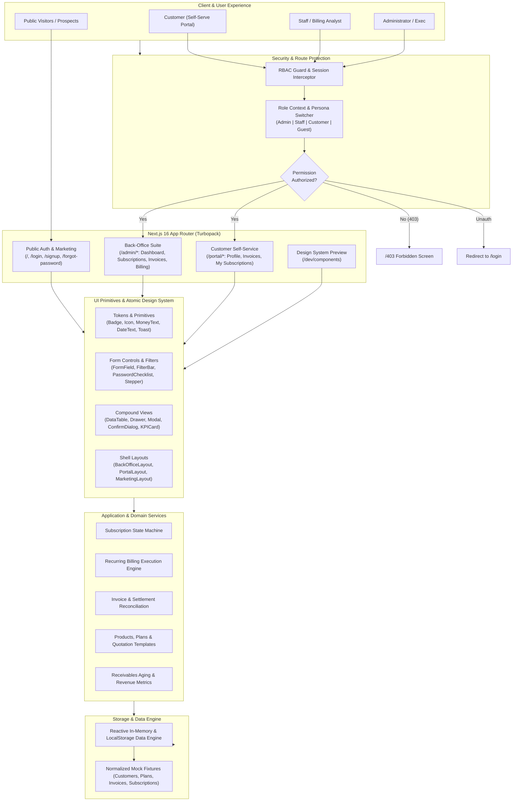
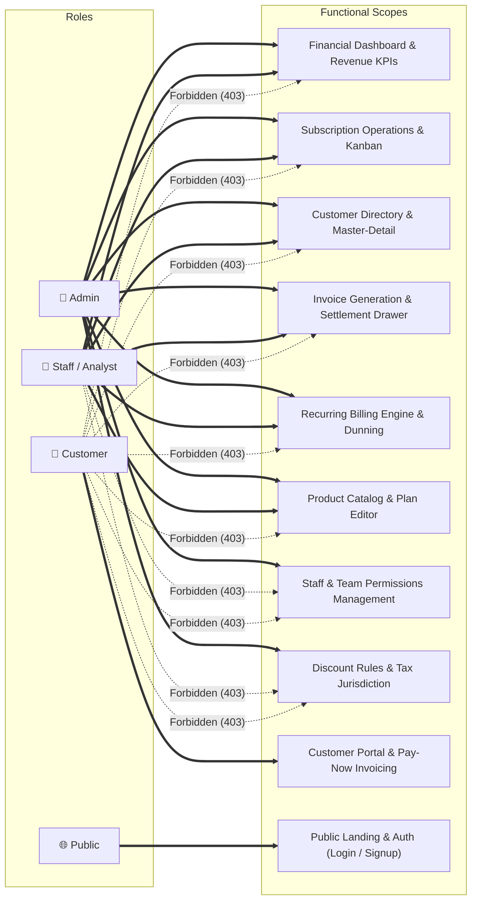
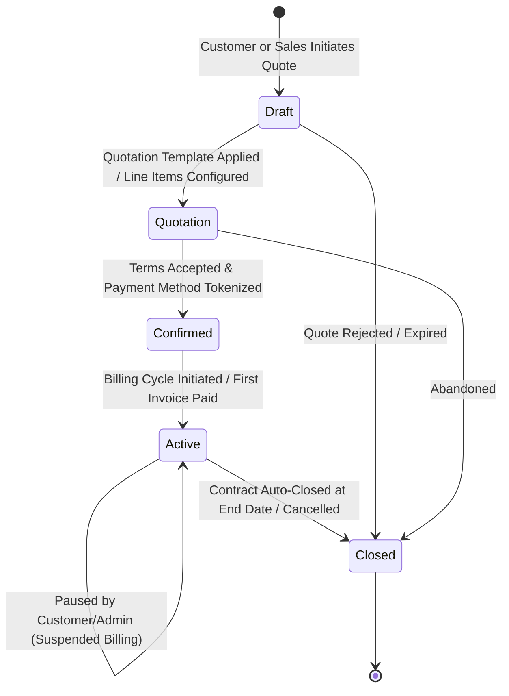
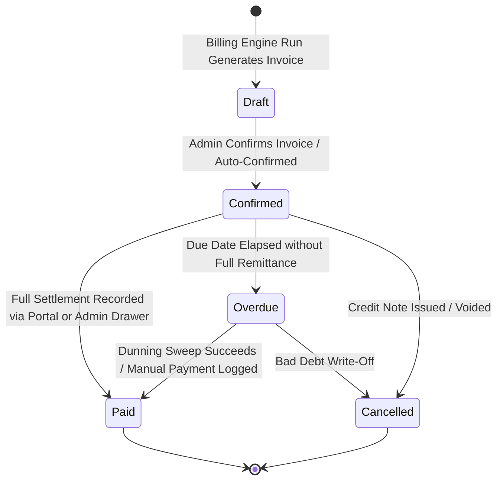
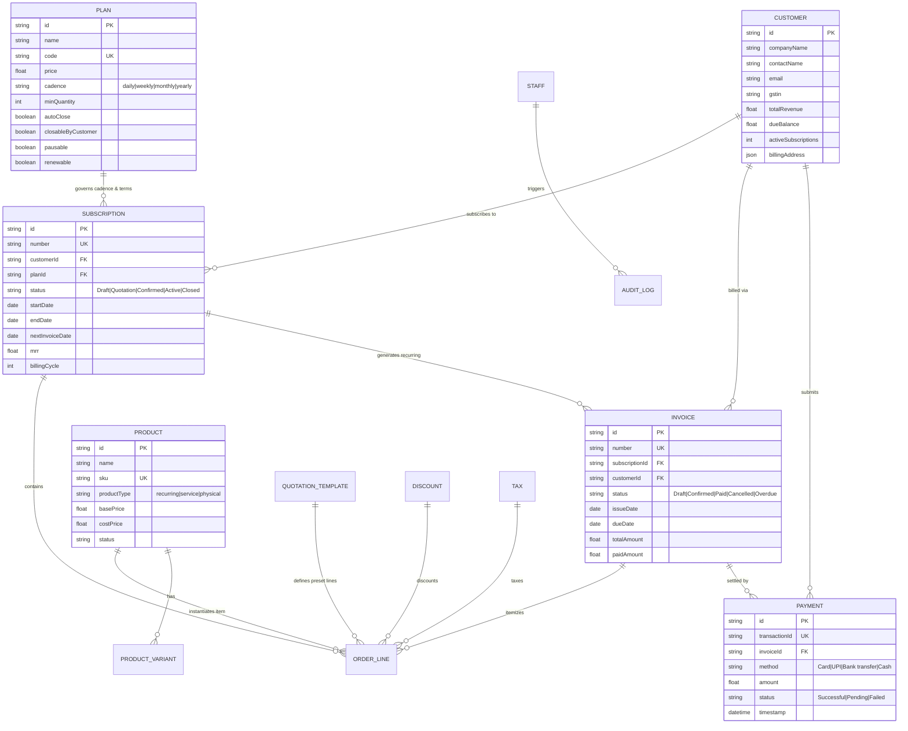

<div align="center">

# ⚡ BrightLoop – SHINRA Subscription Management & Billing Platform

**An enterprise-grade, recurring subscription lifecycle and automated billing management platform built with Next.js 16 App Router, React 19, TypeScript, and the Warm Pragmatic SaaS Design System.**

[](https://nextjs.org/)
[](https://react.dev/)
[](https://www.typescriptlang.org/)
[](https://tailwindcss.com/)
[](https://playwright.dev/)
[](https://tanstack.com/query)

[Explore Features](#-feature-highlights) • [System Design](#-system-design--architecture) • [Route Architecture](#-route-architecture--screen-coverage) • [Quick Start](#-getting-started) • [Quality Assurance](#-testing--quality-assurance)

</div>

---

## 📌 Executive Overview

**BrightLoop (SHINRA)** is a full-featured subscription management and recurring billing web application designed for high-velocity SaaS businesses, enterprise software vendors, and digital service providers. It unifies the entire revenue lifecycle—from customer acquisition and quotation authoring to multi-tier recurring billing cycles, dunning sweeps, receivable aging analytics, and customer self-service.

Engineered with **Next.js 16 App Router (Turbopack)**, **React 19 Server & Client Components**, and **Tailwind CSS v4**, the application follows the **Warm Pragmatic SaaS** design language: a high-contrast palette anchored by Deep Plum (`#714B67`), Deep Teal (`#017E84`), Marker Yellow (`#F5B335`), and clean off-white surfaces (`#F7F9FF` / `#FFFFFF`).

---

## 🏗 System Design & Architecture

### 1. High-Level Platform Architecture



---

### 2. Role-Based Access Control (RBAC) Matrix

BrightLoop enforces strict multi-tenant role boundaries across every screen, drawer, and action button.



| Route Group | Path | Public | Customer | Staff | Admin | Description |
| :--- | :--- | :---: | :---: | :---: | :---: | :--- |
| **Marketing & Auth** | `/`, `/login`, `/signup`, `/forgot-password`, `/reset-password` | ✅ | ✅ | ✅ | ✅ | Public showcase, credential onboarding, password recovery |
| **Admin Analytics** | `/admin/dashboard`, `/admin/reports` | ❌ | ❌ | ✅ | ✅ | Top-line MRR/ARR charts, churn rates, receivables aging ledger |
| **Subscription Lifecycle** | `/admin/subscriptions`, `/admin/subscriptions/:id` | ❌ | ❌ | ✅ | ✅ | Multi-entity table & Kanban view, 5-stage stepper, drawer preview |
| **Customer Directory** | `/admin/customers` | ❌ | ❌ | ✅ | ✅ | Master-detail pane with active contract status & invoice ledger |
| **Billing & Invoices** | `/admin/invoices`, `/admin/payments`, `/admin/run-billing` | ❌ | ❌ | ✅ | ✅ | Manual & scheduled billing engine, settlement drawer, audit logs |
| **Catalog & Templates** | `/admin/plans`, `/admin/products`, `/admin/quotation-templates` | ❌ | ❌ | ✅ | ✅ | Pricing cadences, variant matrices, quote-to-subscription builder |
| **Governance & Security** | `/admin/staff`, `/admin/discounts`, `/admin/taxes` | ❌ | ❌ | ❌ | ✅ | **Admin only:** Staff invites, 2FA status, promo codes, tax rates |
| **Customer Portal** | `/portal`, `/portal/subscriptions`, `/portal/invoices`, `/portal/profile` | ❌ | ✅ | ❌ | ❌ | Self-serve settlement, active subscription cards, profile settings |

---

### 3. Subscription & Invoice Finite State Machines (FSM)

BrightLoop coordinates dual state machines for continuous contract enforcement and automated financial reconciliation:

#### Subscription Lifecycle State Machine



#### Invoice Lifecycle & Settlement State Machine



---

### 4. Entity Relationship Diagram (Domain Model)



---

## 🚀 Feature Highlights

### 1. Executive Operations & Revenue Intelligence
- **Real-Time KPIs**: Top-line tracking of MRR, ARR, active subscriber volume, churn rate, and Average Revenue Per User (ARPU).
- **Receivables Aging Ledger**: Categorized distribution cards (`Current`, `1-30 days`, `31-60 days`, `61-90 days`, `90+ days overdue`) with inline dunning triggers (Immediate Notice, Resend Reminder, Suspend Service).
- **Revenue Analytics Charts**: Interactive Recharts time-series tracking subscription retention, cohort churn, and collection efficiency.

### 2. Advanced Subscription Management
- **Table & Kanban Dual Views**: Toggle between multi-column data grids and interactive workflow boards organized by subscription lifecycle stage.
- **5-Stage Lifecycle Stepper**: Guided workflow transitions across `Draft` ➔ `Quotation` ➔ `Confirmed` ➔ `Active` ➔ `Closed`.
- **Slide-Over Quick Drawers**: Instant inspection of subscription financials, linked contacts, auto-renewal settings, and linked invoices without context switching.

### 3. Invoicing, Payments & Settlement Engine
- **Automated Billing Engine (`/admin/run-billing`)**: On-demand and scheduled execution engine that processes active contracts, computes taxes/discounts, creates invoices, and logs execution audit trails.
- **Slide-Over Settlement Drawer**: Inline recording of payments with method selection (Card, UPI, Bank Wire, Cash), reference code tracking, and automatic receipt generation.
- **Multi-Status Invoice Stepper**: Visual tracking of invoice status (`Draft` ➔ `Confirmed` ➔ `Paid`).

### 4. Catalog, Plans & Quotation Builder
- **Flexible Cadence Support**: Configure billing frequencies (Daily, Weekly, Monthly, Yearly) with minimum commitment quantities.
- **Contract Governance Rules**: Configurable flags for `neverExpire`, `autoClose`, `pausable`, `closableByCustomer`, and `renewable`.
- **Split-Pane Quotation Builder**: Dual-pane authoring workspace to customize line items, product variants, and default plans, converting quotes directly into active subscriptions.

### 5. Self-Service Customer Portal
- **Immediate Settlement**: Responsive payment interface supporting UPI, Credit/Debit cards, Netbanking, and Bank wires.
- **Subscription Self-Service**: Customers can view contract details, download signed agreements, pause services, or request plan upgrades.
- **Profile & Billing Management**: Self-serve management of tax IDs (GSTIN/VAT), primary points of contact, and billing addresses.

### 6. Design System & Accessibility
- **Warm Pragmatic SaaS Design System**: Consistent design token implementation with custom Tailwind CSS variables.
- **WCAG 2.1 AA Compliant**: Automated `@axe-core/playwright` accessibility testing covering color contrast, keyboard navigation, aria labels, and semantic landmark roles.

---

## 🗺 Route Architecture & Screen Coverage

All **34 routes** are fully functional, typed, and integrated:

```
src/app/
├── (marketing)
│   ├── page.tsx                           # / (Public Marketing Landing Page)
│   ├── login/page.tsx                     # /login (RBAC Persona Switcher & Credential Login)
│   ├── signup/page.tsx                    # /signup (Live Password Rules & Onboarding)
│   ├── forgot-password/page.tsx           # /forgot-password (Self-Service Recovery)
│   └── reset-password/page.tsx            # /reset-password (Token-Validated Reset)
├── admin/
│   ├── dashboard/page.tsx                 # /admin/dashboard (MRR, Churn & Executive KPIs)
│   ├── subscriptions/
│   │   ├── page.tsx                       # /admin/subscriptions (Table & Kanban Views)
│   │   ├── [id]/page.tsx                  # /admin/subscriptions/:id (5-Stage Stepper & History)
│   │   └── new/page.tsx                   # /admin/subscriptions/new (Create Subscription)
│   ├── customers/page.tsx                 # /admin/customers (Master-Detail Customer Pane)
│   ├── invoices/
│   │   ├── page.tsx                       # /admin/invoices (Invoice Directory)
│   │   └── [id]/page.tsx                  # /admin/invoices/:id (Lifecycle & Settlement Drawer)
│   ├── payments/page.tsx                  # /admin/payments (Payment Ledger & Record Modal)
│   ├── plans/
│   │   ├── page.tsx                       # /admin/plans (Subscription Plan Directory)
│   │   ├── new/page.tsx                   # /admin/plans/new (New Plan Configuration)
│   │   └── [id]/edit/page.tsx             # /admin/plans/:id/edit (Plan Editor & Simulator)
│   ├── products/
│   │   ├── page.tsx                       # /admin/products (Product Catalog & Variants)
│   │   ├── new/page.tsx                   # /admin/products/new (New Product Creator)
│   │   └── [id]/edit/page.tsx             # /admin/products/:id/edit (Product Editor)
│   ├── quotation-templates/page.tsx       # /admin/quotation-templates (Split-Pane Builder)
│   ├── reports/page.tsx                   # /admin/reports (Receivables Aging & Dunning)
│   ├── run-billing/page.tsx               # /admin/run-billing (Billing Execution Engine)
│   ├── staff/page.tsx                     # /admin/staff (Admin Only: Staff Permissions)
│   ├── discounts/page.tsx                 # /admin/discounts (Admin Only: Promo Codes)
│   └── taxes/page.tsx                     # /admin/taxes (Admin Only: Tax Rules)
├── portal/
│   ├── page.tsx                           # /portal (Customer Home & Spend Summary)
│   ├── subscriptions/
│   │   ├── page.tsx                       # /portal/subscriptions (My Subscriptions)
│   │   └── [id]/page.tsx                  # /portal/subscriptions/:id (Self-Service Contract)
│   ├── invoices/
│   │   ├── page.tsx                       # /portal/invoices (My Invoices & Payment Modals)
│   │   └── [id]/page.tsx                  # /portal/invoices/:id (Pay Now Checkout)
│   └── profile/page.tsx                   # /portal/profile (Account & GSTIN Management)
├── dev/
│   └── components/page.tsx                # /dev/components (UI Component Gallery)
├── 403/page.tsx                           # /403 (Access Restricted Barrier)
└── not-found.tsx                          # Global 404 handler
```

---

## 🎨 Design System Tokens

BrightLoop implements the **Warm Pragmatic SaaS** design system:

| Token | Hex Value | Role in Application |
| :--- | :---: | :--- |
| `primary` | `#714B67` | Deep Plum – Primary brand mark, active nav pills, primary CTAs |
| `primary-hover` | `#5C3C53` | Darkened Plum hover state |
| `primary-container` | `#F5EEF3` | Soft Plum background tint for active selections and badges |
| `secondary` | `#017E84` | Deep Teal – Verification checkpoints, success indicators, settled payments |
| `secondary-container`| `#E0F4F5` | Soft Teal container background |
| `marker-yellow` | `#F5B335` | Marker Yellow – Contextual cursive highlights, pending attention |
| `surface` | `#FFFFFF` | Primary surface for data tables, modal dialogs, and cards |
| `surface-dim` | `#F4F5F6` | Shaded canvas for back-office page backgrounds |
| `surface-bright` | `#F7F9FF` | Crisp canvas for executive overview sections |
| `outline` | `#DEE2E6` | Structural 1px border dividers |
| `on-surface` | `#181C20` | Deep neutral text for primary headings and values |
| `on-surface-variant`| `#49454F` | Secondary neutral for table headers and form descriptions |

Typography utilizes **Inter** for clean UI readability paired with **Caveat** for organic, contextual annotations.

---

## 💻 Tech Stack & Dependencies

| Category | Technology | Version | Purpose |
| :--- | :--- | :--- | :--- |
| **Framework** | [Next.js](https://nextjs.org/) | `16.4.3` | App Router, React Server Components, Turbopack |
| **UI Library** | [React](https://react.dev/) | `19.3.1` | Concurrent rendering, latest Actions and Hooks |
| **Language** | [TypeScript](https://www.typescriptlang.org/) | `6.0.3` | Strict end-to-end type safety |
| **Styling** | [Tailwind CSS](https://tailwindcss.com/) | `4.3.3` | Utility-first styling with modern PostCSS plugin |
| **Server State** | [TanStack React Query](https://tanstack.com/query) | `5.105.0` | Asynchronous data management and cache invalidation |
| **Forms & Validation**| [React Hook Form](https://react-hook-form.com/) + [Zod](https://zod.dev/) | `7.91` / `4.6` | Declarative form state with runtime schema validation |
| **Charts** | [Recharts](https://recharts.org/) | `3.10.1` | Interactive SVGs for MRR trends and receivables aging |
| **Icons** | [Lucide React](https://lucide.dev/) | `1.65.0` | Clean, accessible vector icons |
| **Testing** | [Playwright](https://playwright.dev/) + [Axe-core](https://github.com/dequelabs/axe-core) | `1.64` / `4.14` | Cross-browser automated E2E and WCAG 2.1 a11y testing |
| **Linting** | [ESLint](https://eslint.org/) | `9.39.5` | Next.js and TypeScript linting with flat config |

---

## 🛠 Getting Started

### Prerequisites
- **Node.js**: `v20.x` or higher
- **npm**: `v10.x` or higher

### Installation

1. **Clone the repository**:
   ```bash
   git clone https://github.com/CoderOtakuX/Subscription_Management_System-SHINRA.git
   cd Subscription_Management_System-SHINRA
   ```

2. **Install dependencies**:
   ```bash
   npm install
   ```

3. **Start the local development server**:
   ```bash
   npm run dev
   ```

4. **Open the browser**:
   Navigate to [http://localhost:3000](http://localhost:3000) to view the application.

---

## 🧪 Testing & Quality Assurance

BrightLoop includes a multi-layered verification pipeline ensuring code quality, security boundaries, and accessible user experiences.

### Available Scripts

| Script | Command | Purpose |
| :--- | :--- | :--- |
| `npm run dev` | `next dev` | Start development server with Turbopack |
| `npm run build` | `next build` | Create optimized production build |
| `npm run start` | `next start` | Run production server |
| `npm run typecheck` | `tsc --noEmit` | Strict TypeScript compiler verification |
| `npm run lint` | `eslint src/` | ESLint verification across source directories |
| `npm run check:content` | `node scripts/check-content.mjs` | Automated rule verification for content compliance |
| `npm run test:e2e` | `playwright test` | Execute Playwright E2E and visual tests |
| `npm run verify` | Combined | One-step full pipeline check (Content + TS + Lint + Build + E2E) |

### Testing Suites Overview

1. **RBAC & Route Guard Suite (`tests/guards.spec.ts`)**:
   - Verifies unauthorized roles receive the 403 Access Barrier.
   - Ensures unauthenticated requests redirect securely to `/login`.
2. **Form Interaction & Validation Suite (`tests/forms.spec.ts`)**:
   - Tests form schema validations, dynamic error banners, and submissions.
3. **Accessibility Suite (`tests/a11y.spec.ts`)**:
   - Runs automated Axe-core accessibility audits across critical routes.
4. **Responsive Layout Suite (`tests/responsive.spec.ts`)**:
   - Validates viewport adaptations across Mobile, Tablet, and Desktop resolutions.

---

## 📁 Repository Structure

```
├── .gitignore                      # Git exclusion rules
├── AGENTS.md                       # Agent development guidelines
├── docs/                           # Architecture specifications & token maps
│   ├── design-tokens.md            # Comprehensive color, surface, and font tokens
│   └── screen-map.md               # Complete route catalog & screen inventory
├── eslint.config.mjs               # ESLint configuration
├── next.config.ts                  # Next.js configuration
├── package.json                    # Project dependencies & scripts
├── playwright.config.ts            # Playwright testing configuration
├── postcss.config.mjs              # PostCSS configuration with Tailwind v4
├── scripts/
│   └── check-content.mjs           # Content compliance scanning script
├── src/
│   ├── app/                        # Next.js App Router (34 pages & dynamic routes)
│   ├── components/                 # Atomic UI primitives, tables, modals, & drawers
│   │   ├── layouts/                # Back-office, portal, and marketing shell layouts
│   │   └── ui/                     # Primitives (DataTable, Drawer, Modal, Stepper, etc.)
│   ├── lib/
│   │   ├── auth.ts                 # Session and role state utilities
│   │   ├── format.ts               # Currency and date formatters
│   │   ├── utils.ts                # Class merging utility (clsx + tailwind-merge)
│   │   ├── mock/                   # Normalized domain database fixtures
│   │   └── services/               # Reactive CRUD services with LocalStorage support
│   └── types/                      # Domain interfaces and TypeScript declarations
├── tailwind.config.ts              # Tailwind CSS theme extensions
└── tests/                          # Playwright test specifications
```

---

## 📄 License

This project is open-source and available under the [MIT License](LICENSE).

---

<div align="center">
  <sub>Built with ❤️ by <a href="https://github.com/CoderOtakuX">CoderOtakuX</a> for the <strong>BrightLoop – SHINRA</strong> Subscription Management Platform.</sub>
</div>
